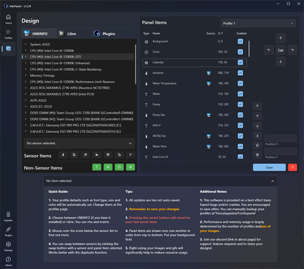

# InfoPanel

<p align=center>
  <a href="https://www.infopanel.net">
    
  </a>
</p>

<p align=center>InfoPanel is a powerful desktop visualization software that transforms how you monitor your system. It displays hardware information on your desktop or external displays as sensor panels, with special support for USB LCD panels like BeadaPanel and Turing Smart Screen/Turzx.</span>

<br />

[Releases][release] | [Reddit][reddit] | [Website][website] | [HWiNFO Forum][forum] | [Discord][discord] | [Microsoft Store][msstore]

 

## InfoPanel 2.0 (branch `2.0.x`, in development)

This branch is InfoPanel 2.0: one cross-platform engine for Windows and macOS that renders your screens with the same Skia code that drives the panels and serves an API and live preview on localhost for an editor in your browser. The editor's preview is the engine's own output, so what you edit is what the panel shows. 2.0 reads 1.x profiles and `.infopanel` exports. It is not released yet: sensors are read on macOS only so far (CPU, GPU, memory, temperatures, fans, power, battery, disk and network, as a normal user; HWiNFO and LibreHardwareMonitor come back as Windows adapters; `--mock` shows mock sensors instead), active screens show as desktop windows on macOS only so far, and panels and plugins are not connected yet.

InfoPanel 1.x, the Windows app described below, keeps shipping from branch [`1.4.x`](https://github.com/habibrehmansg/infopanel/tree/1.4.x).

To run 2.0 from source on macOS or Windows, install the [.NET 10 SDK](https://dotnet.microsoft.com/download), then from the repo root:

```bash
dotnet run --project InfoPanel -c Release                 # the API only: no web client is built from this repo
dotnet run --project InfoPanel -c Release -- --web-root <folder>   # serves a built web client from <folder> and opens it in your browser
```

Without `--web-root`, an engine serves the `wwwroot` folder next to it if that folder contains an `index.html`. Profiles are kept in `~/Library/Application Support/InfoPanel/v2` on macOS and `%LOCALAPPDATA%\InfoPanel\v2` on Windows as 2.0 documents (`profiles/{id}/document.json`), with the media they use stored by content hash in `blobs/`; the first start stores an example profile (on macOS, a panel of the Mac's own sensors). 1.x profiles aren't imported yet, and the engine never reads or changes a 1.x data folder. The engine listens on 127.0.0.1 only. The API and live preview need the token in the sign-in link the engine prints (or opens); the web client's files, the sign-in link and the health check are open to local requests.

### The live preview as video, and ffmpeg

A client can ask for the live preview as H.264 video instead of PNG images. The engine encodes it with the computer's hardware encoder where it has one (VideoToolbox on macOS), otherwise with ffmpeg, if ffmpeg is installed: the engine runs the ffmpeg it finds as a separate program and doesn't include one. Without either, the preview stays images. To use ffmpeg, install a build with libx264 (the usual packages have it):

- **macOS:** `brew install ffmpeg` ([Homebrew](https://brew.sh)).
- **Windows:** `winget install ffmpeg`, or download a build from [ffmpeg.org](https://ffmpeg.org/download.html) and add its `bin` folder to your `PATH`.
- **Linux, Raspberry Pi OS:** `sudo apt install ffmpeg` (or your distribution's package).

The engine looks for ffmpeg once, the first time a preview asks for video: at the path given with `--ffmpeg <path>` if there is one, otherwise on the `PATH` the engine was started with, then (except on Windows) in `/opt/homebrew/bin` and `/usr/local/bin`, where an app started from the Dock or Finder doesn't look. It checks that ffmpeg really encodes with a tiny test before using it, and logs which ffmpeg it found and its version. `--h264 software` uses ffmpeg even where there is a hardware encoder, and `--h264 off` turns video off.

For development and tests, see [`CLAUDE.md`](CLAUDE.md). What still has to come over from 1.x is in [`PORTING.md`](PORTING.md).

## Features

- **Multiple Data Sources**: 
  - HWiNFO integration via Shared Memory (SHM) for extensive hardware monitoring
  - LibreHardwareMonitor for additional sensor data without requiring HWiNFO
  - Extensible plugin system with built-in and third-party plugins

- **Display Options**:
  - Desktop overlay with customizable transparency and positioning
  - External display support for monitors
  - USB LCD panel support including BeadaPanel via WinUSB API
  - Multiple visualization types: text, gauges, graphs, bars, donuts, and images

- **Advanced Visualization**:
  - GIF animation support for dynamic visualizations
  - High refresh rates for smooth updates
  - Customizable layouts, colors, and fonts
  - Multiple profiles for different use cases or displays

- **Plugin System**:
  - Built-in system information plugins (CPU, memory, network, drives)
  - Weather information integration
  - Support for third-party plugins
  - Sensor data tables with customizable formatting



## Supported Hardware

- All hardware sensors exposed by HWiNFO
- CPU, GPU, RAM, storage, and network monitoring via LibreHardwareMonitor
- BeadaPanel USB LCD panels (all models supported)
- TuringPanel/TURZX displays (Models A, C, and E)
- Any standard monitor or display

For detailed information about supported panels and recommendations, see our [Display Panels Guide](PANELS.md).

## Usage

1. Install either HWiNFO (with Shared Memory support enabled) or use the built-in LibreHardwareMonitor integration
2. Install InfoPanel from the [Microsoft Store][msstore] or the [website][website]
3. Configure your display profile with sensors, gauges, and visualizations
4. Customize layouts with drag-and-drop interface
5. Connect USB displays or position on your desktop
6. (Optional) Install additional plugins for enhanced functionality

## Plugins

InfoPanel features a robust plugin system that extends its capabilities:

### Built-in Plugins
- **System Info Plugin**: CPU usage, memory usage, process statistics, and system uptime
- **Network Info Plugin**: Network interfaces, IP addresses, and connection statistics
- **Drive Info Plugin**: Storage device information and usage statistics
- **Volume Plugin**: Audio volume control and monitoring
- **Weather Plugin**: Current weather conditions and forecasts

### Community Plugins
- [InfoPanel Spotify Plugin](https://github.com/F3NN3X/InfoPanel.Spotify) - Displays currently playing tracks and album art from Spotify
- [InfoPanel FPS Plugin](https://github.com/F3NN3X/InfoPanel.FPS) - Shows FPS and performance metrics for gaming sessions
- [InfoPanel YouTube Live Plugin](https://github.com/fweepa/InfoPanel.YoutubeLivePlugin) - Plays a YouTube Live stream in your panel

To browse all available community plugins or submit your own, see the [Plugin Registry](PLUGIN-REGISTRY.md).

### Plugin Development
InfoPanel provides a comprehensive API for plugin development that allows access to:
- Sensor data creation and publishing
- Custom visualizations
- Data tables for complex information
- Configuration interfaces

For detailed instructions on developing plugins, see our [Plugin Development Guide](PLUGINS.md).

## Demo


*A demonstration of InfoPanel in action on a BeadaPanel USB LCD*

## Development

InfoPanel 1.x is built with C# and WPF for a modern Windows UI experience (2.0 is described above). The architecture features:

- Modular design with MVVM pattern
- Extensible plugin system
- DirectX acceleration for UI elements
- High-performance graphics rendering for external displays
- Cross-device synchronization

## License

InfoPanel is licensed under GPL 3.0 - see the [license file][license] for details.

---

InfoPanel is not affiliated with HWiNFO. HWiNFO is a registered trademark of its respective owners.

<!--
References
-->

[reddit]: https://www.reddit.com/r/InfoPanel/
[website]: https://www.infopanel.net
[forum]: https://www.hwinfo.com/forum/threads/infopanel-desktop-visualisation-software.8673/
[discord]: https://discord.gg/aNGeJxjE7Q
[msstore]: https://apps.microsoft.com/store/detail/XPFP7C8H5446ZD
[release]: https://github.com/habibrehmansg/infopanel/releases
[license]: https://github.com/habibrehmansg/infopanel/blob/main/LICENSE
