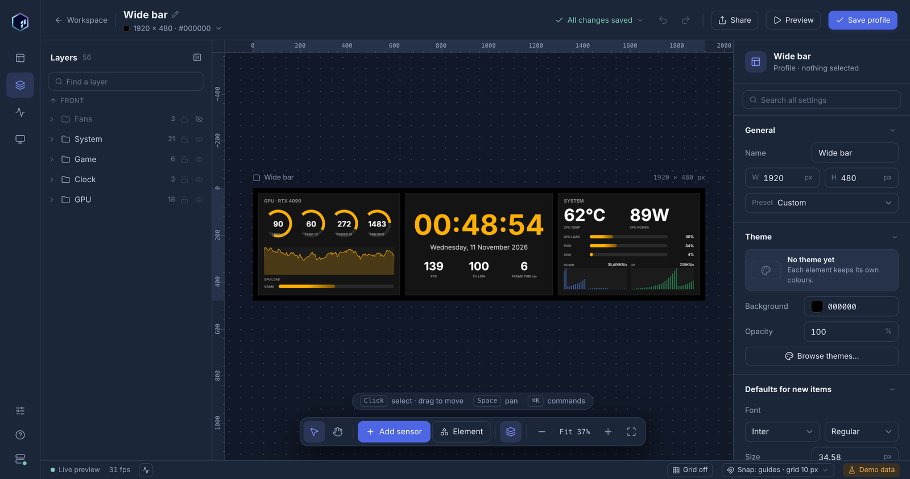
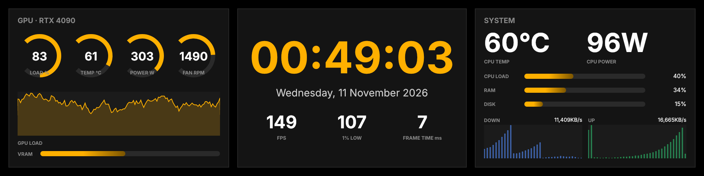
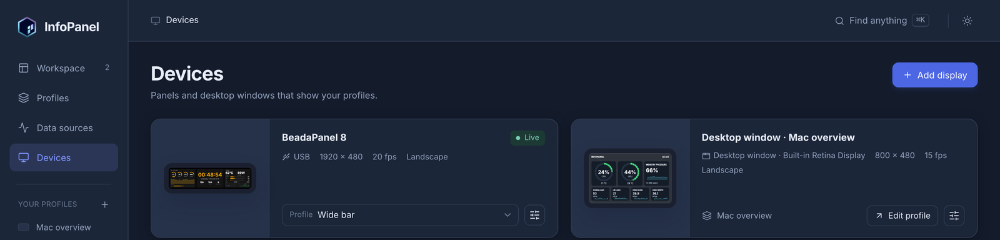
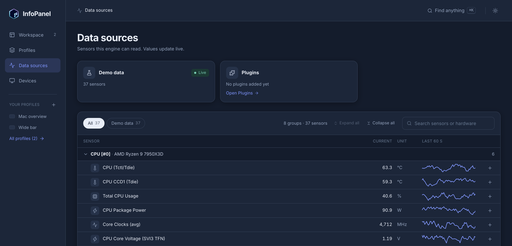

<p align="center">
  <a href="https://www.infopanel.net"></a>
</p>

<h1 align="center">InfoPanel</h1>

<p align="center">Your computer's live readings on a USB screen or a desktop window, laid out the way you want.</p>

InfoPanel reads your computer's sensors (CPU and GPU temperatures, load, fan speeds, memory, drives, network) and draws them on a small USB panel or in a window on your desktop. **Open Editor** opens [app.infopanel.net][editor], where you design your panels in the browser. The preview there is drawn by InfoPanel itself, so what you see is what the panel shows.

**[Download](#download) · [Documentation](docs/2.0/README.md) · [Discord][discord] · [Reddit][reddit]**



## Download

InfoPanel 2.0 is in beta: try it, and [tell us what breaks][issues]. Builds are on the [Releases page][releases] as pre-releases; until one is there, [build from source](#build-from-source).

- **Mac** (Apple silicon, macOS 15 or later): `InfoPanel-<version>-mac-arm64.dmg`
- **Windows** (x64, Windows 10 or later): `InfoPanel-<version>-win-x64-setup.exe`

Each release lists the files' SHA-256 in `SHA256SUMS`.

**On a Mac**, open the disk image and drag InfoPanel to Applications. The app isn't notarised yet, so the first time you open it macOS says it can't verify it: choose **Done**, then System Settings › Privacy & Security › **Open Anyway**. InfoPanel lives in the menu bar, with no Dock icon.

**On Windows**, run the setup. It isn't signed yet, so SmartScreen may say "Windows protected your PC": choose **More info**, then **Run anyway**. It installs as InfoPanel 2 in `C:\Program Files\InfoPanel 2` and sits in the notification area by the clock. **Start when I sign in**, in its menu, starts it with Windows.

Then choose **Open Editor** in the menu (on Windows, a click on the icon does the same). Starting InfoPanel again while it runs opens the editor too. InfoPanel includes an example profile to start from.

**Coming from InfoPanel 1.x?** On Windows, 2.0 installs beside it and leaves 1.x's program, settings and profiles alone. If InfoPanel finds your 1.x profiles, the first time you open the editor it opens Import with them, so you can bring them over.

**Updates.** Once a day InfoPanel checks GitHub for a newer release. When there is one, its menu says **Update Available** and you get one notification; both open the release page. **Check for Updates…** checks straight away.

## Where it shows

**USB panels.** All 21 BeadaPanel models, from 320 × 480 up to the 1920 × 480 bars. InfoPanel finds a panel you plug in and saves it switched off; give it a profile and turn it on, and it shows that profile live, rotated as you set it and scaled to fit ([USB panels](docs/2.0/panels.md)). The BeadaPanel 8 and its 1920 × 480 relatives get JPEG frames, about twice as many a second as raw ones. A panel another program is using is left alone.



**Desktop windows** (macOS and Windows). Any profile can have a window of its own on your desktop; **Show on Desktop** in the menu turns each one on or off. **Click-Through** lets clicks pass to whatever is underneath.



## What it reads

- **On a Mac:** the Mac's own sensors (CPU and GPU, temperatures, fans, power, memory, battery, disk and network throughput), with no administrator rights.
- **On Windows:** [HWiNFO][hwinfo], with Shared Memory Support turned on in its settings (the free version stops sharing after 12 hours; readings ticked "Report value in Gadget" come through too), and LibreHardwareMonitor, built in. LibreHardwareMonitor needs the PawnIO driver for the CPU's temperatures and the board's fans and voltages: the setup carries PawnIO's installer, and InfoPanel runs it when you choose **Install PawnIO**. Some sensors need administrator rights as well: **Read all sensors** sets up a task that reads them as SYSTEM. InfoPanel never elevates itself.
- **On Linux:** the hwmon and thermal-zone sensors in `/sys`.
- **Everywhere:** the clock, your drives, network interfaces and public address, uptime and the busiest processes, and the weather, which needs the configured weather service. Volume on macOS and Windows.
- **Plugins:** .NET plugins add sensors, texts and tables of their own. Add the plugin package to the data folder's `plugins` folder and restart InfoPanel; each package runs in its own process ([plugins](docs/2.0/plugins.md), [writing one](PLUGINS.md), [community plugins](PLUGIN-REGISTRY.md)).



A profile can hold text and live values, graphs, tables, images and SVG, image-sequence gauges, web images and cameras. Video files and RTSP cameras need FFmpeg's libraries, which the downloads don't include; MJPEG cameras work without them ([video](docs/2.0/video.md)).

## Platforms

| | macOS | Windows | Linux |
|---|---|---|---|
| Download | Disk image | Setup | None: build from source |
| Hardware sensors | The Mac's own | HWiNFO, LibreHardwareMonitor | hwmon, thermal zones |
| Clock, drives, network, system info | Yes | Yes | Yes |
| Weather¹ | Yes | Yes | Yes |
| Volume | Yes | Yes | No |
| USB panels | Yes | Yes | With the system's libusb; build from source |
| Desktop windows | Yes | Yes | No |
| Menu | Menu bar | Notification area | No |
| Plugins | Yes² | Yes | Yes² |

¹ Needs the configured weather service. ² Plugins using Windows-only libraries run only on Windows.

InfoPanel keeps your profiles, media, settings and logs in `~/Library/Application Support/InfoPanel/v2` on macOS and `%LOCALAPPDATA%\InfoPanel\v2` on Windows ([the data folder](docs/2.0/data-folder.md)). Uninstalling on Windows keeps it.

## Build from source

You need the [.NET 10 SDK](https://dotnet.microsoft.com/download) (`global.json` pins the version). From the repository's root:

```bash
dotnet build InfoPanel.slnx
dotnet test InfoPanel.slnx
dotnet run --project InfoPanel -c Release        # the engine, on your real sensors
dotnet run --project InfoPanel -- --help         # every flag
```

A build from source has no editor built in, so on its own it serves the engine's API and live preview; `--help` explains `--web-root` and `--allow-origin`. On Windows, LibreHardwareMonitor runs in a sensor helper that only a publish includes: `dotnet publish InfoPanel -c Release -r win-x64`, then run the engine from the publish folder; a source build doesn't carry PawnIO's installer, and reading every sensor needs the engine under Program Files ([the PawnIO driver](spec/docs/api.md#the-pawnio-driver), [reading all sensors](spec/docs/api.md#reading-all-sensors)). On macOS, USB panels need `brew install libusb`.

`packaging/macos/build.sh` and `packaging\windows\build.ps1` build the disk image and the setup ([packaging](docs/2.0/packaging.md)).

Release builds send crash reports to Sentry, with names, paths and addresses removed, unless you turn them off (`telemetry.crashReports`); a build from source sends nothing ([crash reports](docs/2.0/crash-reports.md)).

The documentation starts at [docs/2.0](docs/2.0/README.md). The profile formats and the engine's API, for anyone writing a client, are in [`spec/`](spec/README.md). [`CLAUDE.md`](CLAUDE.md) is the guide to the code.

## Contributing

Issues are welcome: a bug, a sensor that reads wrong, a page of the docs that's out of date. Pull requests open after 2.0's first release ([contributing](CONTRIBUTING.md)). To report a vulnerability, see [security](SECURITY.md). Questions and ideas go to [Discord][discord] or [Reddit][reddit].

## Licence

InfoPanel is licensed under GPL 3.0 - see the [license file][license] for details.

The formats and the API contract in `spec/` (its schemas, documentation and generated types) are under the MIT licence, [`spec/LICENSE`](spec/LICENSE), so anyone can build a client on them.

Contributions need the contributor agreement, [`CLA.md`](CLA.md): you keep the copyright in your contribution and give Habib Rehman a broad licence to use and license it, including under other terms.

Third-party components are listed in [LICENSES.md](LICENSES.md).

InfoPanel is not affiliated with HWiNFO. HWiNFO is a registered trademark of its respective owners.

[editor]: https://app.infopanel.net
[releases]: https://github.com/habibrehmansg/infopanel/releases
[issues]: https://github.com/habibrehmansg/infopanel/issues
[discord]: https://discord.gg/aNGeJxjE7Q
[reddit]: https://www.reddit.com/r/InfoPanel/
[hwinfo]: https://www.hwinfo.com
[license]: LICENSE
